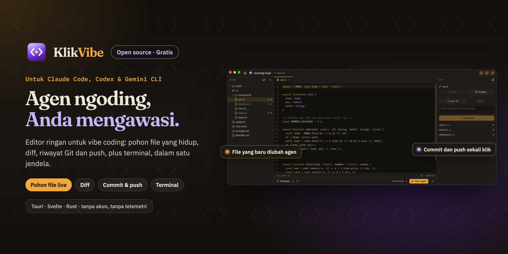

<p align="center">
  
</p>

<h1 align="center">KlikVibe</h1>

<p align="center"><a href="README.md">English</a> · <b>Bahasa Indonesia</b></p>

<p align="center">
  Editor kode yang gratis, open source, dan ringan untuk vibe coding. Biarkan agen AI menulis kode di terminal bawaan, dan Anda tetap mengawasinya: file, diff, riwayat Git, dan push dalam satu jendela kecil yang cepat.
</p>

<p align="center">
  <a href="LICENSE"></a>
  
  
  
  <a href="https://github.com/ashafizullah/klikvibe/releases/latest"></a>
  <a href="https://github.com/ashafizullah/klikvibe/releases"></a>
</p>

<p align="center">
  Bagian dari <a href="https://klikapps.pages.dev"><b>Klik Apps</b></a>, keluarga aplikasi desktop gratis dan open source: <a href="https://klikapps.pages.dev">klikapps.pages.dev</a>
</p>

## Fitur

- **Terminal lebih dulu.** Shell terbuka di folder proyek, sebanyak yang Anda perlukan (agen di satu terminal, dev server di terminal lain). Tombol *Jalankan agen* mengetikkan perintah agen Anda (Claude Code, Codex, Gemini CLI, OpenCode, Oh My Pi, Command Code, Amp, Qwen Code, Kimi CLI, Droid, Copilot CLI, Crush, Cursor CLI, atau Aider); Anda tinggal menekan Enter.
- **Beberapa proyek sekaligus,** masing-masing di tab sendiri dengan file, panel Git, dan terminalnya sendiri, jadi agen tetap bekerja di satu proyek saat Anda melihat proyek lain.
- **Agen melihat apa yang Anda lihat (MCP).** Aktifkan server MCP lokal dan tambahkan ke agen Anda dengan satu perintah: agen bisa membaca file dan kode yang sedang Anda pilih, melihat editan yang belum disimpan, serta membuka file dan diff di KlikVibe untuk Anda periksa.
- **Tahu saat agen butuh Anda.** Saat agen selesai bekerja lalu diam (menunggu jawaban, atau sudah selesai), KlikVibe menampilkan notifikasi, jadi Anda bisa mengerjakan hal lain sambil menunggu. Path di output-nya bisa diklik untuk membuka file di baris itu.
- **Batalkan yang dilakukan agen.** Checkpoint menyimpan file Anda selama agen bekerja, terpisah dari commit; kembalikan salah satunya untuk kembali ke sebelum sebuah perubahan.
- **Arahkan agen ke kode.** Klik kanan kode, file, atau diff lalu pilih "Tanya agen tentang ini" untuk menempelkan rujukannya ke terminal agen.
- **Pekerjaan agen terlihat langsung.** Pohon file, file yang terbuka, dan panel Git mengikuti isi disk saat file berubah. File yang baru disentuh berkedip di pohon file, dan file yang terbuka dimuat ulang sendiri, kecuali ada editan yang belum Anda simpan di sana.
- **Kode saat Anda butuh.** CodeMirror 6 dengan pewarnaan sintaks untuk bahasa-bahasa umum, pencarian, dan edit lalu simpan (`⌘S` / `Ctrl+S`). Gambar, video, audio, dan PDF tampil sebagai pratinjau; file biner lain dan file yang sangat besar tidak dibuka.
- **Git tanpa pindah aplikasi.**
  - Daftar perubahan, masing-masing dengan diff.
  - Commit semua dengan pesan (`⌘↵`).
  - Pull (hanya fast-forward), push, atau publikasikan branch baru.
  - Riwayat, dengan tanda pada commit yang belum di-push; klik commit untuk melihat patch-nya.
  - `git init` untuk folder baru.

  KlikVibe menjalankan `git` milik Anda sendiri, jadi kredensial, kunci SSH, dan hook bekerja sama seperti di terminal.
- **Kecil dan offline.** Tauri 2 + Svelte 5 + Rust. Tanpa akun, tanpa telemetri, tanpa cloud: server MCP (opsional) hanya mendengarkan di komputer Anda sendiri.
- Bahasa Inggris dan Bahasa Indonesia.

## Instal

**macOS** (Apple Silicon + Intel, macOS 11 atau lebih baru): jalankan ini di Terminal untuk memasang atau memperbarui:
```sh
curl -fsSL https://raw.githubusercontent.com/ashafizullah/klikvibe/main/install.sh | bash
```
Atau unduh `KlikVibe_*_universal.dmg` dari [rilis terbaru](https://github.com/ashafizullah/klikvibe/releases/latest), buka, lalu seret KlikVibe ke Applications. Aplikasi ini sudah ditandatangani dan dinotarisasi Apple.

**Windows**: unduh `KlikVibe_*_x64-setup.exe` (atau `.msi`) dari [rilis terbaru](https://github.com/ashafizullah/klikvibe/releases/latest).

**Linux** (x86_64): unduh `.deb`, `.rpm`, atau `.AppImage`.

KlikVibe memeriksa versi baru sekali sehari dan memasangnya setelah Anda setuju. Git harus sudah terpasang, begitu juga agen yang ingin Anda jalankan (Claude Code, Codex, Gemini CLI).

## Build dari kode sumber

Anda butuh [Bun](https://bun.sh/), Rust stable, dan Git. Di Linux, pasang juga [prasyarat Tauri](https://v2.tauri.app/start/prerequisites/#linux).

```sh
bun install
bun run tauri dev                    # jalankan aplikasi
bun run tauri dev -- -- ~/my-app     # jalankan dengan folder proyek langsung terbuka
bun run tauri build                  # buat paket instalasi
```

Kalau KlikVibe sudah berjalan, peluncuran kedua dengan folder (`klikvibe <folder>`) akan membuka folder itu di jendela yang sama.

## Pintasan

| | macOS | Windows / Linux |
|---|---|---|
| Buka folder | ⌘O | Ctrl+O |
| Buka proyek lain (tab proyek baru) | ⌘T | Ctrl+T |
| Proyek berikutnya / sebelumnya | Ctrl+Tab / Ctrl+Shift+Tab | Ctrl+Tab / Ctrl+Shift+Tab |
| Ke proyek 1–9 | ⌘1–⌘9 | Ctrl+1–Ctrl+9 |
| Simpan | ⌘S | Ctrl+S |
| Tutup tab | ⌘W | Ctrl+W |
| Panel file | ⌘B | Ctrl+B |
| Panel kode | ⌘⇧E | Ctrl+Shift+E |
| Cari file berdasarkan nama | ⌘P | Ctrl+P |
| Cari di isi file | ⌘⇧F | Ctrl+Shift+F |
| Panel Git | ⌘⇧G | Ctrl+Shift+G |
| Terminal | Ctrl+` | Ctrl+` |
| Commit (di kotak pesan) | ⌘↵ | Ctrl+Enter |

## Keamanan

Jendela aplikasi hanya bisa mengakses folder yang Anda buka sendiri, lewat dialog folder, argumen peluncuran, atau daftar proyek terakhir yang disimpan di sisi Rust. Setiap perintah file dan Git memeriksa path-nya terhadap folder tersebut, termasuk symlink, dan KlikVibe tidak pernah menulis ke dalam `.git`. Lihat [SECURITY.md](SECURITY.md).

## Berkontribusi

Lihat [CONTRIBUTING.md](CONTRIBUTING.md). `./scripts/check.sh` menjalankan semua pengecekan.

## Lisensi

[MIT](LICENSE)

KlikVibe dibangun di atas:

- [Tauri](https://tauri.app) (MIT OR Apache-2.0)
- [CodeMirror](https://codemirror.net) (MIT)
- [xterm.js](https://xtermjs.org) (MIT)
- [portable-pty](https://github.com/wezterm/wezterm) (MIT)
- [notify](https://github.com/notify-rs/notify) (CC0-1.0)
- [ignore](https://github.com/BurntSushi/ripgrep) (MIT OR Unlicense)

KlikVibe juga menyertakan ikon Lucide (ISC) serta font antarmuka Fraunces, IBM Plex Sans, dan IBM Plex Mono (SIL Open Font License 1.1). Semua lisensi pihak ketiga ada di [`THIRD_PARTY_NOTICES.md`](THIRD_PARTY_NOTICES.md). Jalankan `bun run notices` setelah mengubah dependensi; skrip ini gagal jika ada lisensi di luar daftar lisensi permisif.

Claude dan Claude Code adalah merek dagang Anthropic. Codex adalah merek dagang OpenAI. Gemini adalah merek dagang Google LLC. Git adalah merek dagang Software Freedom Conservancy. Nama produk lain adalah merek dagang pemiliknya masing-masing. KlikVibe adalah proyek independen dan tidak berafiliasi dengan atau didukung oleh pihak-pihak tersebut.

<p>
  <a href="https://github.com/ashafizullah"></a>
  &nbsp;Dibuat oleh <a href="https://github.com/ashafizullah"><b>Adam Suchi Hafizullah</b></a>
</p>
