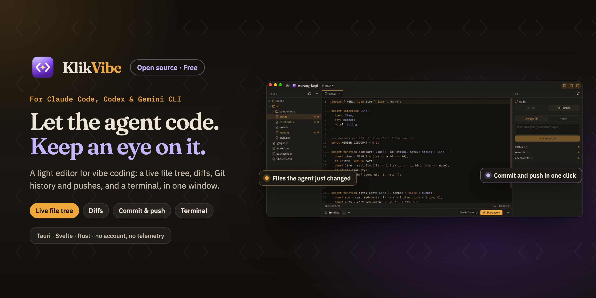

<p align="center">
  
</p>

<h1 align="center">KlikVibe</h1>

<p align="center"><b>English</b> · <a href="README.id.md">Bahasa Indonesia</a></p>

<p align="center">
  A free, open-source, lightweight code editor for vibe coding. Let your AI agent write the code in the built-in terminal, and keep an eye on it: files, diffs, Git history and pushes in one small, fast window.
</p>

<p align="center">
  <a href="LICENSE"></a>
  
  
  
</p>

<p align="center">
  Part of <a href="https://klikapps.pages.dev"><b>Klik Apps</b></a>, a family of free, open-source desktop apps: <a href="https://klikapps.pages.dev">klikapps.pages.dev</a>
</p>

## What it does

- **Terminal first.** Shells open in the project folder, as many as you need (the agent in one, the dev server in another). *Start agent* types `claude`, `codex` or `gemini` for you; you press Enter.
- **Live view of the agent's work.** The file tree, open files and the Git panel follow the disk as files change. Files touched in the last moments pulse in the tree, and open files reload by themselves unless you have unsaved edits there.
- **Code when you want it.** CodeMirror 6 with syntax highlighting for the common languages, search, and editing with save (`⌘S` / `Ctrl+S`). Binary and very large files are not opened.
- **Git without leaving.**
  - Changes, each with a diff.
  - Commit all with a message (`⌘↵`).
  - Pull (fast-forward only), push, or publish a new branch.
  - History, with unpushed commits marked; click a commit to see its patch.
  - `git init` for a new folder.

  It runs your own `git`, so your credentials, SSH keys and hooks work as in a terminal.
- **Small and offline.** Tauri 2 + Svelte 5 + Rust. No account, no telemetry, no server.
- English and Bahasa Indonesia.

## Install and run

No release builds yet. To run from source you need [Bun](https://bun.sh/), stable Rust and Git. On Linux, also install the [Tauri prerequisites](https://v2.tauri.app/start/prerequisites/#linux).

```sh
bun install
bun run tauri dev                    # run the app
bun run tauri dev -- -- ~/my-app     # run it with a project folder open
bun run tauri build                  # bundle
```

A running KlikVibe also opens a folder passed to a second launch (`klikvibe <folder>`).

## Shortcuts

| | macOS | Windows / Linux |
|---|---|---|
| Open folder | ⌘O | Ctrl+O |
| Save | ⌘S | Ctrl+S |
| Close tab | ⌘W | Ctrl+W |
| Files panel | ⌘B | Ctrl+B |
| Git panel | ⌘⇧G | Ctrl+Shift+G |
| Terminal | Ctrl+` | Ctrl+` |
| Commit (in the message box) | ⌘↵ | Ctrl+Enter |

## Security

The window can only reach folders you opened yourself, through the folder dialog, the launch arguments, or the recent list kept by the Rust side. Every file and Git command checks its path against them, with symlinks resolved, and KlikVibe never writes inside `.git`. See [SECURITY.md](SECURITY.md).

## Contributing

See [CONTRIBUTING.md](CONTRIBUTING.md). `./scripts/check.sh` runs every check.

## License

[MIT](LICENSE)

KlikVibe is built on:

- [Tauri](https://tauri.app) (MIT OR Apache-2.0)
- [CodeMirror](https://codemirror.net) (MIT)
- [xterm.js](https://xtermjs.org) (MIT)
- [portable-pty](https://github.com/wezterm/wezterm) (MIT)
- [notify](https://github.com/notify-rs/notify) (CC0-1.0)
- [ignore](https://github.com/BurntSushi/ripgrep) (MIT OR Unlicense)

It also bundles the Lucide icons (ISC) and the interface fonts Fraunces, IBM Plex Sans and IBM Plex Mono (SIL Open Font License 1.1). Every third-party license is in [`THIRD_PARTY_NOTICES.md`](THIRD_PARTY_NOTICES.md). Run `bun run notices` after changing dependencies; it fails on a license outside the permissive allow-list.

Claude and Claude Code are trademarks of Anthropic. Codex is a trademark of OpenAI. Gemini is a trademark of Google LLC. Git is a trademark of the Software Freedom Conservancy. Other product names are trademarks of their owners. KlikVibe is an independent project and is not affiliated with or endorsed by any of them.

<p>
  <a href="https://github.com/ashafizullah"></a>
  &nbsp;Built by <a href="https://github.com/ashafizullah"><b>Adam Suchi Hafizullah</b></a>
</p>
